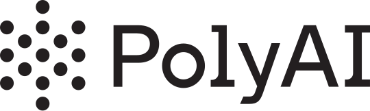
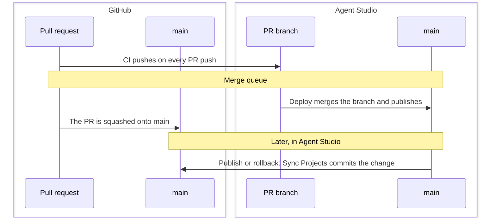

<picture>
  <source media="(prefers-color-scheme: dark)" srcset=".github/assets/polyai-logo-on-dark.png">
  
</picture>

# ADK Repo Template

[](https://github.com/polyai/adk-repo-template/actions/workflows/ci.yml)
[](https://github.com/polyai/adk)
[](https://www.python.org/downloads/)
[](LICENSE)
[](https://github.com/astral-sh/ruff)
[](https://claude.ai/download)

Template repository for ADK-managed agent projects. Each project under `agents/` is an Agent Studio project, managed with the [PolyAI ADK](https://github.com/polyai/adk). Pull requests push changes to Agent Studio, and the merge queue merges them there. A sync workflow brings changes made in Agent Studio back into the repo.

New to PolyAI? Sign up at [studio.poly.ai](https://studio.poly.ai) and start free.

**[Use this template](https://github.com/new?template_name=adk-repo-template&template_owner=polyai)** · **[Set up a new repo](SETUP.md)** · **[ADK documentation](https://polyai.github.io/adk/)**

- [How it works](#how-it-works): how changes move between git and Agent Studio.
- [Getting started](#getting-started): set up your machine to work on projects in an existing repo.
- [Development workflow](#development-workflow): branches, pull requests, and trying changes in Agent Studio.
- [Adding a project](#adding-a-project): bring a project the repo doesn't have yet.
- [Syncing from Agent Studio](#syncing-from-agent-studio): when the sync workflow runs.
- [Keeping up to date](#keeping-up-to-date): the ADK version and the template's workflows.
- [Troubleshooting](#troubleshooting): common failures and their fixes.
- [Setting up a new repo](SETUP.md): one-off setup for repo admins.

## How it works



A pull request's changes go to an Agent Studio branch with the same name as the git branch, where you can test them. The merge queue merges that branch into Agent Studio main, which publishes the project, and squashes the PR onto git `main`. Changes published in Agent Studio come back to git `main` through the Sync Projects workflow.

```
agents/
  <account>/
    <project>/          # Agent Studio project
.github/
  workflows/            # CI, deploy, sync, branch cleanup
  scripts/              # Shared shell + Python scripts for CI
```

See [CONTRIBUTING.md](CONTRIBUTING.md) for the full structure and for writing unit tests.

## Getting started

Requires Python 3.14+ and [uv](https://github.com/astral-sh/uv).

```bash
# Create and activate a virtual environment
uv venv --python=3.14 --seed
source .venv/bin/activate

# Install the ADK and dev tools
uv pip install -e ".[dev]"

# Install the git hooks
pre-commit install

# Sign in to Agent Studio
poly setup
```

`poly setup` asks for your region, signs you in through the browser and saves an API key to `~/.poly/credentials.json`. It also offers shell completion and AI agent skills for your coding agent. When it asks **Set up a project?**, choose **Skip for now**: the projects you work on are already in the repo. To sign in without the other steps, run `poly login --region <region>` instead.

The project you work on is at `agents/<account>/<project>/`. Run `poly` commands from that directory.

The git hooks format each project you commit to with `.github/scripts/format-project.sh`, the same formatting a sync from Agent Studio applies, then run the ruff and ty checks CI runs, plus a JSON syntax check. If the hook reformats files, the commit stops: to fix this, add the changes and commit. Ensure when you commit you use the virtual environment, as the hooks use its `ruff`.

In VS Code, select the `.venv` interpreter: `Cmd+Shift+P` > **"Python: Select Interpreter"** > choose `.venv/bin/python`.

## Development workflow

### Making changes

1. Create a git branch. Then, from the project directory, create the Agent Studio branch with the same name (from main). Your files are kept:

   ```bash
   poly branch create $(git branch --show-current)
   ```

   The ADK tracks its Agent Studio branch separately from git, so switching git branches doesn't move it. Check it with `poly branch current`. For a branch CI has already pushed, switch to it instead. This loads the branch's state into the project files:

   ```bash
   poly branch switch $(git branch --show-current)
   ```

2. Make your changes and commit them.
3. Open a PR. CI runs lint and tests, then pushes your changes to the Agent Studio branch.
4. Merge through the merge queue. Deploy merges the Agent Studio branch into Agent Studio main, which publishes the project.

### Trying changes in Agent Studio

CI pushes to the Agent Studio branch on every PR push. To try a change before pushing to GitHub, run these from the project directory, on the Agent Studio branch that matches your git branch:

```bash
# Push to the Agent Studio branch
poly push

# Pull from Agent Studio
poly pull

# Chat with the agent on your Agent Studio branch, pushing local changes first
poly chat --push

# Call the agent with your microphone and speaker (needs a non-main branch)
poly call --push
```

> [!NOTE]
> `poly push` sends your local project files to the Agent Studio branch. It is not a git push.

`poly chat` talks to the last pushed state of your Agent Studio branch, and `--environment` picks another environment instead. `poly call` only reaches a branch's draft build, not main. Its audio dependencies come with the `dev` extras. See the ADK docs for [`poly chat`](https://polyai.github.io/adk/reference/cli/chat/), [`poly call`](https://polyai.github.io/adk/reference/cli/call/), [testing](https://polyai.github.io/adk/development/testing/) and the [full CLI reference](https://polyai.github.io/adk/reference/cli/).

### Lint and test

The git hooks and CI run these for you. To run them yourself, from the repo root:

```bash
# Run tests for a project
pytest agents/<account>/<project>/

# Lint
ruff check agents/<account>/<project>/
ruff format --check agents/<account>/<project>/
```

## Adding a project

Only for a project that isn't in `agents/` yet. From the repo root:

```bash
poly init --base-path agents --region <region> --account_id <account> --project_id <project>
```

This pulls the project into `agents/<account>/<project>/`. A fresh pull isn't formatted the way CI expects, so format it before committing. The hooks only see files git knows about, so stage the project first:

```bash
git add agents/<account>/<project>
pre-commit run --all-files
git add agents/<account>/<project>
```

Then commit it on a branch and open a PR. CI finds projects by their `project.yaml`, so nothing else needs registering. Once it's merged, [set up the sync webhook](SETUP.md#5-agent-studio-webhooks) for the project.

## Syncing from Agent Studio

The **Sync Projects** workflow pulls the latest state from Agent Studio into the repo and pushes it to `main`. It runs:

- when Agent Studio sends a dispatch after a publish or rollback (see [Agent Studio webhooks](SETUP.md#5-agent-studio-webhooks))
- nightly at 03:00 UTC
- when the ADK version in `pyproject.toml` changes
- manually, from the Actions tab

> [!NOTE]
> A merge can't overwrite changes made in Agent Studio that haven't been synced yet. In the merge queue, Deploy checks that Agent Studio main matches git `main`, and fails the PR with `AS branch main is not in sync with git main` if a sync would change anything. Run Sync Projects for the project, then re-queue the PR. The webhook keeps the repo in sync, so this rarely happens.

## Keeping up to date

### Updating the ADK version

1. Check the [ADK releases](https://github.com/polyai/adk/releases) for changelogs and breaking changes.
2. Update the version in `pyproject.toml`.
3. Run `uv pip install -e ".[dev]"` locally to check it installs.
4. Open a PR. Once it merges, Sync Projects re-syncs every project with the new ADK version.

### Syncing infrastructure from the template

Repos made from this template pick up workflow and hook changes from it with:

```bash
.github/scripts/sync-from-template.sh            # preview
.github/scripts/sync-from-template.sh --apply    # apply and commit
```

This syncs `.github/workflows/`, `.github/scripts/`, `.github/assets/` and `.pre-commit-config.yaml`.

## Troubleshooting

| Symptom | Cause |
| ------- | ----- |
| `poly push` or `poly chat` uses the wrong Agent Studio branch | The ADK's branch doesn't follow git. Check `poly branch current`, then create or switch to the branch named after your git branch (see [Making changes](#making-changes)). |
| CI fails ruff or prettier on a newly added project | It was committed straight after `poly init`. Format it with the hooks as in [Adding a project](#adding-a-project). |
| A PR fails in the merge queue with `AS branch main is not in sync with git main` | Agent Studio has changes the repo doesn't. Run Sync Projects for the project, then re-queue. To merge anyway and overwrite the Agent Studio changes, add the `skip-as-sync-check` label and re-queue. |
| Publishing starts no run | GitHub rejected the dispatch, usually because the token can't see the repo (its resource owner isn't the organisation, or the repo isn't selected) or the secret is missing, misnamed, or lacks the `Bearer ` prefix or project access. See [Agent Studio webhooks](SETUP.md#5-agent-studio-webhooks). |
| Sync Projects fails at the GitHub App token step with `Invalid keyData` | `GH_APP_PRIVATE_KEY` isn't a valid key. Set it from the `.pem` file (see [GitHub App](SETUP.md#2-github-app)). |
| Sync Projects fails at find-projects with `No projects found` | The project isn't on `main` yet, or the dispatch's `account_id`/`project_id` don't match its `project.yaml`. |

## License

Apache License 2.0. See [LICENSE](LICENSE).
